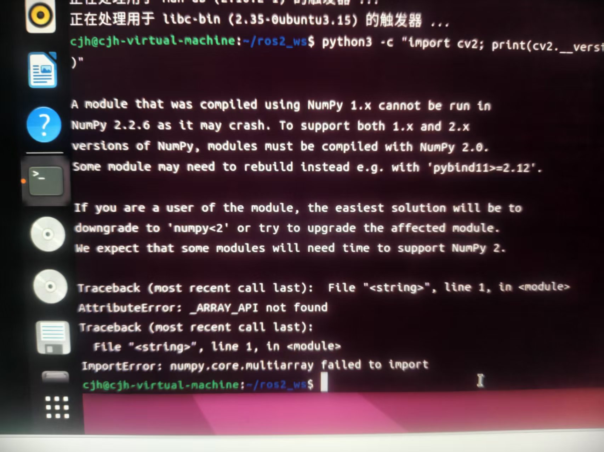
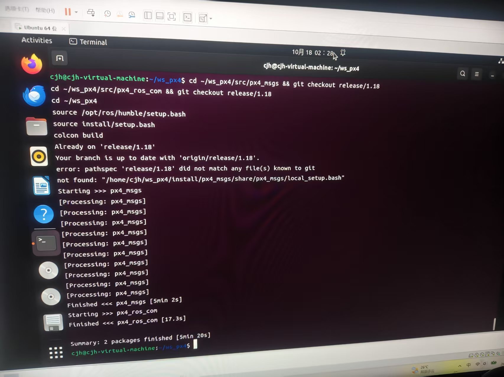
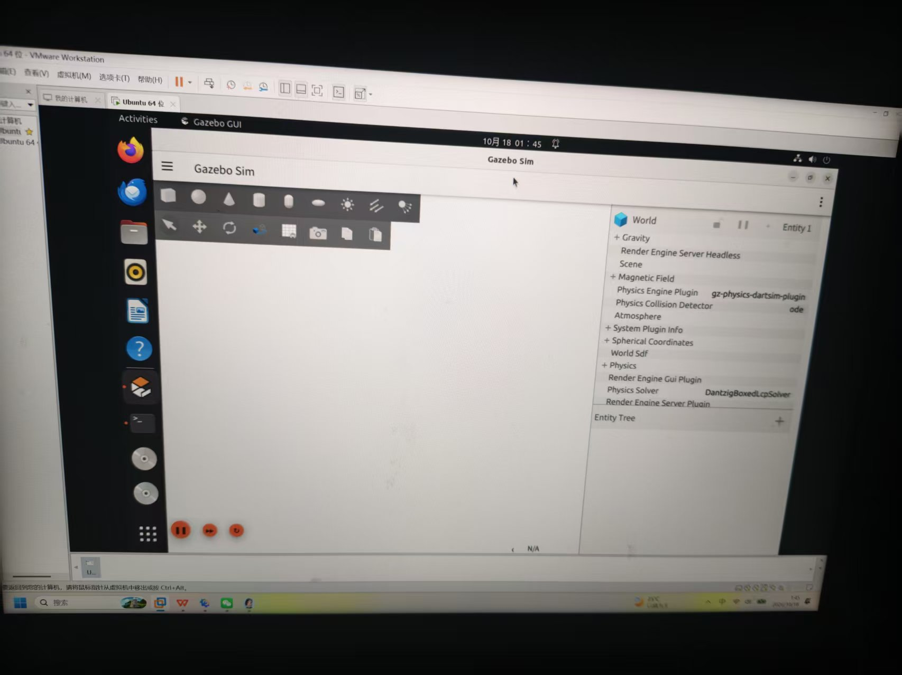
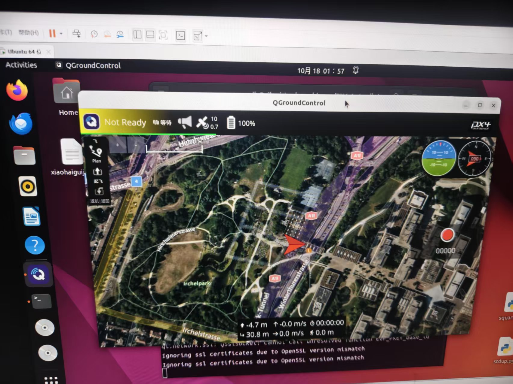
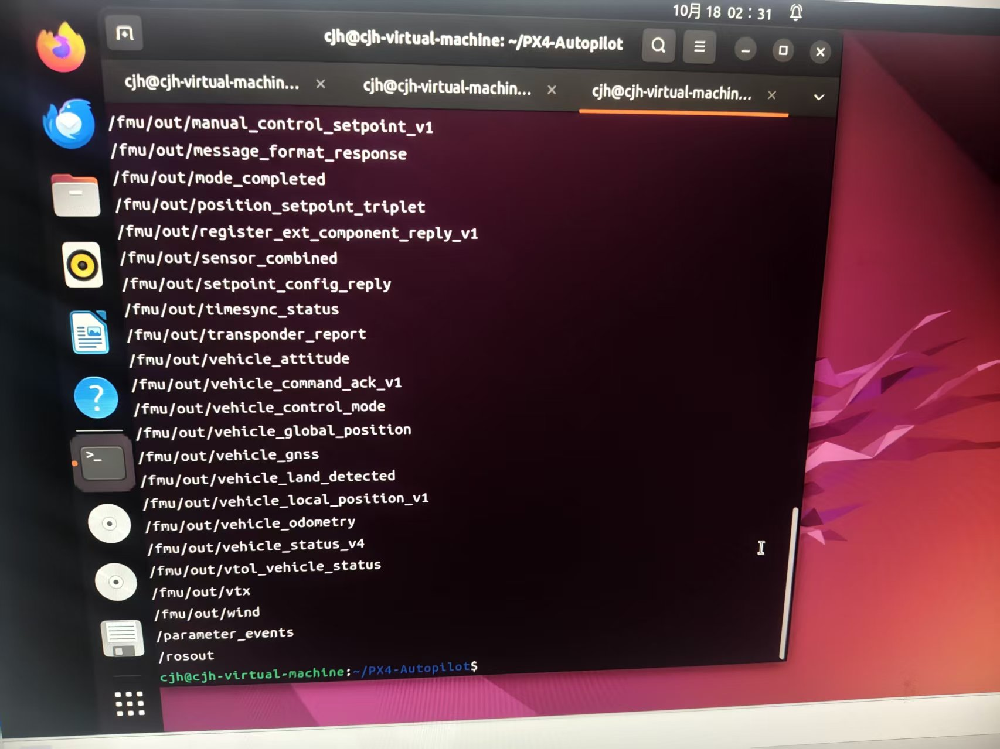

# PX4 + ROS2 + OpenCV 无人机视觉追踪：从零到实现

本文档记录在一台 VMware 虚拟机（Ubuntu 22.04.5 LTS）上，从零搭建 **PX4 v1.18 + ROS2 Humble + QGroundControl + OpenCV** 无人机视觉追踪系统的完整过程。所有截图均为实际操作过程中的真实记录，包含安装、编译、通信验证与踩坑解决。

## 1. 环境与工程总览

### 1.1 运行环境


| 项目        | 版本 / 说明                             |
| --------- | ----------------------------------- |
| 操作系统      | Ubuntu 22.04.5 LTS（VMware 虚拟机，64 位） |
| 登录用户      | `cjh@cjh-virtual-machine`           |
| ROS 版本    | ROS2 Humble Hawksbill               |
| PX4 固件    | PX4-Autopilot，`release/1.18` 分支     |
| 地面站       | QGroundControl                      |
| 仿真环境      | Gazebo Sim（新版 gz，非 Classic）         |
| 视觉库       | OpenCV 4.x（Python 3.10，cv2）         |
| ROS2 工作空间 | `~/ws_px4`                          |
| PX4 源码目录  | `~/PX4-Autopilot`                   |

### 1.2 工程结构


```
~/ws_px4/src/
├── px4_msgs/              # release/1.18 分支
├── px4_ros_com/           # 桥接与示例
└── vision_tracking/       # 自建视觉追踪功能包
    ├── launch/
    ├── scripts/
    │   ├── image_pub.py
    │   └── color_tracker.py
    └── offboard_control.py
```

## 2. 安装 ROS2 Humble 与 OpenCV

### 2.1 安装 ROS2 Humble


```
sudo apt update && sudo apt install -y locales software-properties-common curl
sudo locale-gen en_US en_US.UTF-8
sudo add-apt-repository universe
sudo curl -sSL https://raw.githubusercontent.com/ros/rosdistro/master/ros.key \
  -o /usr/share/keyrings/ros-archive-keyring.gpg
echo "deb [arch=$(dpkg --print-architecture) signed-by=/usr/share/keyrings/ros-archive-keyring.gpg] http://packages.ros.org/ros2/ubuntu $(. /etc/os-release && echo $UBUNTU_CODENAME) main" \
  | sudo tee /etc/apt/sources.list.d/ros2.list > /dev/null
sudo apt update
sudo apt install -y ros-humble-desktop python3-colcon-common-extensions python3-rosdep python3-pip
echo "source /opt/ros/humble/setup.bash" >> ~/.bashrc && source ~/.bashrc
```

### 2.2 验证 OpenCV（真实踩坑：NumPy 2.x 冲突）

安装 OpenCV 后，在终端执行：


```
python3 -c "import cv2; print(cv2.__version__)"
```

如果终端出现如下报错 ——`A module that was compiled using NumPy 1.x cannot be run in NumPy 2.2.6`、`AttributeError: _ARRAY_API not found`、`ImportError: numpy.core.multiarray failed to import`：




这是因为 pip 默认安装了 NumPy 2.x，而系统 OpenCV 是按 NumPy 1.x 编译的。解决方法是降级 NumPy：


```
pip3 install "numpy<2"
```

再次执行 `python3 -c "import cv2; print(cv2.__version__)"`，正常输出版本号即通过。

## 3. 编译 PX4 v1.18 与 ROS2 桥接包

### 3.1 克隆 PX4 源码


```
cd ~
git clone https://github.com/PX4/PX4-Autopilot.git --recursive ~/PX4-Autopilot
cd ~/PX4-Autopilot
git checkout release/1.18
git submodule update --init --recursive
bash ./Tools/setup/ubuntu.sh --no-nuttx
```

### 3.2 编译 px4\_msgs 与 px4\_ros\_com

PX4 v1.18 对应的 ROS2 桥接包也需切到 `release/1.18` 分支：


```
mkdir -p ~/ws_px4/src && cd ~/ws_px4/src
git clone https://github.com/PX4/px4_msgs.git
git clone https://github.com/PX4/px4_ros_com.git

cd ~/ws_px4/src/px4_msgs && git checkout release/1.18
cd ~/ws_px4/src/px4_ros_com && git checkout release/1.18

cd ~/ws_px4
source /opt/ros/humble/setup.bash
colcon build
```

编译成功后终端输出 `Summary: 2 packages finished`，如下图所示（`px4_msgs` 用了约 5 分钟，`px4_ros_com` 约 17 秒）：




> 注意：上图中 
>
> `px4_ros_com`
>
>  曾报 
>
> `error: pathspec 'release/1.18' did not match any file(s) known to git`
>
> ，说明该仓库没有 
>
> `release/1.18`
>
>  分支。此时改用 
>
> `git checkout main`
>
>  或与 PX4 版本匹配的分支即可，不影响 
>
> `colcon build`
>
>  最终成功。

## 4. 启动 Gazebo Sim 仿真环境

PX4 v1.18 默认使用新版 Gazebo Sim（不是 Gazebo Classic）。启动 SITL 仿真：


```
cd ~/PX4-Autopilot
make px4_sitl gz_x500
```

启动后 Gazebo Sim 窗口打开，左侧是建模工具栏，右侧是 World / Entity Tree 面板。首次启动时世界可能为空（没有无人机模型），如下图：




等待 PX4 SITL 加载完成，无人机模型会自动出现在世界中。若长时间为空，按 `Ctrl+C` 后重新执行 `make px4_sitl gz_x500`。

## 5. 启动 QGroundControl 地面站

QGroundControl 是 PX4 官方地面站，用于查看无人机状态、切换模式、监控遥测。启动后自动连接本机 SITL：


```
# 下载并运行（首次）
sudo usermod -a -G dialout $USER
# QGroundControl.AppImage 可从官网下载后执行
./QGroundControl.AppImage
```

启动后界面如下：顶部状态条显示当前连接状态（"Not Ready" 为未解锁 / 未起飞的正常状态），中间是卫星地图视图，红色箭头表示无人机当前位置与朝向，右侧是飞行姿态仪表盘：




SITL 默认通过 UDP 14540 与 QGC 通信，连接成功后状态条会从黄色 "Not Ready" 变为绿色。

## 6. 验证 PX4-ROS2 通信

新开终端，加载 ROS2 与工作空间环境，查看 PX4 发布的话题：


```
source /opt/ros/humble/setup.bash
source ~/ws_px4/install/setup.bash
ros2 topic list
```

成功后会列出大量 `/fmu/out/*` 话题，包括 `/fmu/out/vehicle_attitude`、`/fmu/out/vehicle_local_position_v1`、`/fmu/out/vehicle_odometry`、`/fmu/out/vehicle_status_v4`、`/fmu/out/sensor_combined` 等，如下图所示：




读取姿态数据验证数据链路：


```
ros2 topic echo /fmu/out/vehicle_attitude --once
```

能打印出四元数数据即说明 PX4 ↔ ROS2 双向通信打通。

## 7. OpenCV 视觉目标检测

### 7.1 颜色追踪节点

用 HSV 阈值 + 轮廓检测提取红色目标质心，发布到 `/vision/target`：


```
# vision_tracking/color_tracker.py
#!/usr/bin/env python3
import cv2, numpy as np, rclpy
from rclpy.node import Node
from sensor_msgs.msg import Image
from cv_bridge import CvBridge
from geometry_msgs.msg import PointStamped

class ColorTracker(Node):
    def __init__(self):
        super().__init__('color_tracker')
        self.bridge = CvBridge()
        self.sub = self.create_subscription(Image, '/camera/image_raw', self.cb, 10)
        self.pub = self.create_publisher(PointStamped, '/vision/target', 10)

    def cb(self, msg):
        frame = self.bridge.imgmsg_to_cv2(msg, 'bgr8')
        h, w = frame.shape[:2]
        hsv = cv2.cvtColor(frame, cv2.COLOR_BGR2HSV)
        lower1 = np.array([0, 120, 70]);  upper1 = np.array([10, 255, 255])
        lower2 = np.array([170, 120, 70]); upper2 = np.array([180, 255, 255])
        mask = cv2.inRange(hsv, lower1, upper1) | cv2.inRange(hsv, lower2, upper2)
        mask = cv2.morphologyEx(mask, cv2.MORPH_OPEN, np.ones((5,5), np.uint8))
        contours, _ = cv2.findContours(mask, cv2.RETR_EXTERNAL, cv2.CHAIN_APPROX_SIMPLE)
        if not contours: return
        c = max(contours, key=cv2.contourArea)
        if cv2.contourArea(c) < 300: return
        M = cv2.moments(c)
        if M['m00'] == 0: return
        cx, cy = int(M['m10']/M['m00']), int(M['m01']/M['m00'])
        p = PointStamped()
        p.header.stamp = self.get_clock().now().to_msg()
        p.point.x = cx - w/2    # 横向偏差
        p.point.y = cy - h/2    # 纵向偏差
        p.point.z = float(cv2.contourArea(c))   # 面积→距离估计
        self.pub.publish(p)

def main(args=None):
    rclpy.init(args=args); rclpy.spin(ColorTracker()); rclpy.shutdown()
```

## 8. Offboard 机外控制

订阅 `/vision/target`，把像素误差映射为速度设定点，10Hz 持续下发：


```
# vision_tracking/offboard_control.py
#!/usr/bin/env python3
import time, rclpy
from rclpy.node import Node
from geometry_msgs.msg import PointStamped
from px4_msgs.msg import OffboardControlMode, TrajectorySetpoint, VehicleCommand

class OffboardControl(Node):
    def __init__(self):
        super().__init__('offboard_control')
        self.off_pub = self.create_publisher(OffboardControlMode, '/fmu/in/offboard_control_mode', 10)
        self.traj_pub = self.create_publisher(TrajectorySetpoint, '/fmu/in/trajectory_setpoint', 10)
        self.cmd_pub = self.create_publisher(VehicleCommand, '/fmu/in/vehicle_command', 10)
        self.create_subscription(PointStamped, '/vision/target', self.on_target, 10)
        self.target = None; self.armed = False; self.t0 = time.time()
        self.create_timer(0.1, self.control_cb)

    def on_target(self, msg): self.target = msg

    def control_cb(self):
        mode = OffboardControlMode()
        mode.timestamp = int(time.time()*1e6); mode.velocity = True
        self.off_pub.publish(mode)

        vx = vy = vz = 0.0
        if self.target:
            vy = -0.12 * self.target.point.x
            vz = -0.08 * self.target.point.y
            vx = 0.02 * (15000 - self.target.point.z)
            vx = max(-1.5, min(1.5, vx)); vy = max(-1.5, min(1.5, vy))

        sp = TrajectorySetpoint()
        sp.timestamp = int(time.time()*1e6)
        sp.position = [float('nan'), float('nan'), -2.0]  # NED，负=升空
        sp.velocity = [vx, vy, vz]; sp.yaw = 0.0
        self.traj_pub.publish(sp)

        if time.time() - self.t0 > 2.0 and not self.armed:
            self.send_cmd(176, 0.0, 6.0)   # 切 Offboard
            time.sleep(0.2)
            self.send_cmd(400, 1.0, 0.0)   # ARM 解锁
            self.armed = True
            self.get_logger().info('Offboard + ARM 完成')

    def send_cmd(self, command, p1, p2):
        cmd = VehicleCommand()
        cmd.timestamp = int(time.time()*1e6)
        cmd.command = command; cmd.param1 = p1; cmd.param2 = p2
        self.cmd_pub.publish(cmd)

def main(args=None):
    rclpy.init(args=args); rclpy.spin(OffboardControl()); rclpy.shutdown()
```

## 9. 启动流程与验收

分三个终端启动：


```
# 终端1：PX4 SITL（Gazebo Sim）
cd ~/PX4-Autopilot && make px4_sitl gz_x500

# 终端2：QGroundControl（另开窗口，自动连接 SITL）
./QGroundControl.AppImage

# 终端3：ROS2 视觉追踪
source /opt/ros/humble/setup.bash && source ~/ws_px4/install/setup.bash
ros2 launch vision_tracking vision_tracking.launch.py
```

追踪效果演示视频：[tracking\_demo.mp4](img/tracking_demo.mp4)

## 10. 常见问题（真实踩坑记录）

**Q1：**`import cv2`**&#x20;报&#x20;**`_ARRAY_API not found`**？**

NumPy 2.x 与系统 OpenCV 不兼容。执行 `pip3 install "numpy<2"` 降级即可（对应第 2.2 节截图）。

**Q2：**`git checkout release/1.18`**&#x20;报&#x20;**`pathspec did not match`**？**

`px4_ros_com` 仓库可能没有 `release/1.18` 分支，改用 `git checkout main` 或与 PX4 版本匹配的分支。`colcon build` 仍能正常完成（对应第 3.2 节截图）。

**Q3：Gazebo Sim 启动后世界是空的？**

模型加载需要等待。若长时间为空，`Ctrl+C` 后重新执行 `make px4_sitl gz_x500`；确认使用的是 `gz_x500`（新版 Gazebo）而非 `gazebo-classic` 目标（对应第 4 节截图）。

**Q4：QGroundControl 显示 "Not Ready"？**

未解锁或未切 Offboard 模式属于正常状态。SITL 通过 UDP 14540 自动连接；若一直连不上，确认 PX4 SITL 已启动且防火墙未阻断 14540 端口（对应第 5 节截图）。

**Q5：**`ros2 topic list`**&#x20;看不到&#x20;**`/fmu/out/*`**？**

Micro XRCE-DDS Agent 未启动或 PX4 未连接。确认 `MicroXRCEAgent udp4 -p 8888` 已运行，且 PX4 已启用 `uxrce_dds_client` 模块。连接成功后即可看到全部 `/fmu/out/*` 话题（对应第 6 节截图）。

**Q6：解锁后立刻翻机？**

控制循环中断或模式切换顺序错误。确保 10Hz 定时器持续运行、先切 Offboard（command=176, param2=6）再 ARM（command=400）。


***

> 本文档基于 Ubuntu 22.04.5 LTS + VMware 虚拟机真实操作记录，环境版本：ROS2 Humble、PX4 release/1.18、Gazebo Sim、QGroundControl。